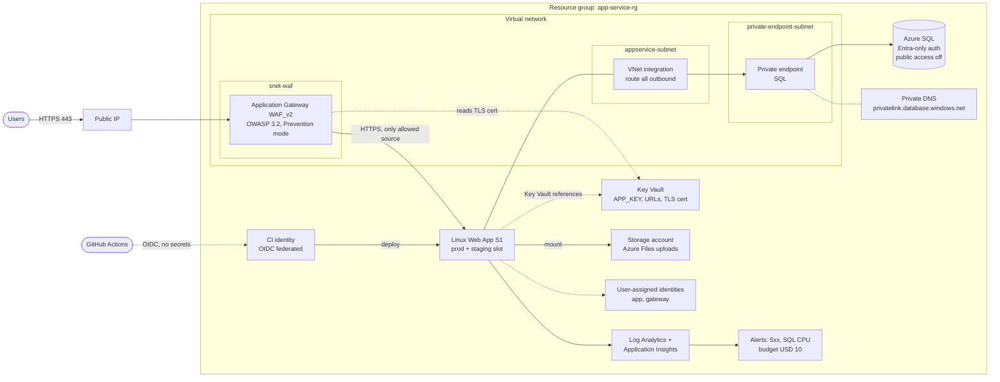

# Zero-Trust Laravel on Azure App Service (Terraform)

A Laravel app hosted on Azure App Service where nothing is reachable directly
from the internet except an Application Gateway with a WAF. The web app,
database, secrets and file storage all sit behind private networking and
managed identities. No passwords are used to reach the database.

Everything is defined in Terraform, split into nine modules.

## Architecture



Solid lines are request or data paths. Dotted lines are identity, DNS and
control-plane relationships.

## How a request flows

1. The user hits the public IP of the Application Gateway on 443. Port 80 is
   permanently redirected to HTTPS.
2. The WAF policy (OWASP 3.2, Prevention mode, request body inspection,
   128 KB limit) blocks malicious requests before they reach the app.
3. The gateway forwards to the web app over HTTPS. The web app has an
   access restriction that only allows traffic from the gateway subnet, so the
   default `*.azurewebsites.net` address returns 403 to anyone else. The SCM
   (Kudu) site follows the same rule.
4. The app reaches Azure SQL through a private endpoint. SQL has public network
   access disabled and accepts Microsoft Entra authentication only. The app
   signs in with its user-assigned managed identity, so there is no database
   password anywhere.
5. Laravel secrets (`APP_KEY`, app URL, database hosts) are App Service
   Key Vault references, resolved at runtime by the same identity.

## Modules

| Module | What it creates |
| --- | --- |
| `network` | VNet; subnets for the gateway, App Service (delegated), private endpoints and database; public IP for the gateway |
| `gateway` | Application Gateway WAF_v2, prod and staging listeners on separate hostnames, HTTP→HTTPS redirects, TLS certificate pulled from Key Vault |
| `appservice` | Linux plan (S1), web app plus staging slot, VNet integration, gateway-only access restrictions, health check on `/api/health`, autoscale, Azure Files mount |
| `db` | Azure SQL server with Entra-only auth, prod and staging databases, private endpoint and private DNS zone |
| `identity` | User-assigned identities for the app and the gateway |
| `security` | Key Vault and secrets, WAF policy, GitHub Actions identity with OIDC federated credentials |
| `storage` | Storage account (TLS 1.2) and a 50 GB file share for uploads |
| `observability` | Log Analytics, Application Insights, diagnostic settings, action group, alerts on HTTP 5xx and SQL CPU |
| `governance` | Monthly budget with 50% and 100% alerts, Azure Policy limiting deployment regions |

## Security controls

| Control | How it is done |
| --- | --- |
| Single public entry point | Only the Application Gateway has a public IP |
| Web application firewall | OWASP 3.2 managed rules in Prevention mode |
| App locked to the gateway | `ip_restriction` on the gateway subnet for the app, slot and SCM site |
| Passwordless database | Entra-only SQL auth with a managed identity |
| Private database | Public access off, private endpoint and private DNS |
| Secrets out of config | Key Vault references in App Service settings |
| No CI secrets | GitHub Actions authenticates with OIDC federation |
| TLS everywhere | HTTPS only, TLS 1.2 minimum on app and storage |
| Cost and region guardrails | Budget alerts and an Allowed Locations policy |

## Deploying

Prerequisites: Terraform 1.5+, Azure CLI, an Azure subscription, and a TLS
certificate already uploaded to Key Vault for the gateway.

```bash
az login
cp credentials.example.tf credentials.tf   # fill in your own values, never commit it
terraform init
terraform plan -out tfplan
terraform apply tfplan
```

After the first apply, grant the app identity access inside the database
(Azure SQL users for managed identities can't be created from Terraform):

```sql
-- use the app identity's name: id-webapp-<project_name>
CREATE USER [id-webapp-myproject] FROM EXTERNAL PROVIDER;
ALTER ROLE db_datareader ADD MEMBER [id-webapp-myproject];
ALTER ROLE db_datawriter ADD MEMBER [id-webapp-myproject];
ALTER ROLE db_ddladmin  ADD MEMBER [id-webapp-myproject]; -- needed for php artisan migrate
```

Then point your DNS records for the prod and staging hostnames at the gateway's
public IP.

## Known gaps and next steps

These are deliberate trade-offs for a lab budget, or work still to do:

- Key Vault and the storage account still allow public network access
  (`default_action = "Allow"`). Next step: set them to `Deny` and add private
  endpoints for both.
- Key Vault purge protection is off so the lab can be destroyed and rebuilt.
- The storage account key is passed to the app as a setting. Moving uploads to
  identity-based access would remove it.
- The gateway runs at a fixed capacity of 1 instance with no availability
  zones; production would use autoscaling across zones.
- Terraform state is local. [PROJ_005](https://github.com/Cloud-n-devops/PROJ_005_AZURE_BOOSTRAP)
  sets up a remote backend and CI pipeline that this project will move onto.

## Related projects

- [PROJ_001](https://github.com/Cloud-n-devops/PROJ_001_APPSERVICE_LARAVEL): the same app on App Service without the gateway
- [PROJ_002](https://github.com/Cloud-n-devops/PROJ_002_APP_GATEWAY_WAF): the gateway and WAF pattern on its own
- [PROJ_004](https://github.com/Cloud-n-devops/PROJ_004_K8S_AZURE): the app on AKS
- [PROJ_005](https://github.com/Cloud-n-devops/PROJ_005_AZURE_BOOSTRAP): subscription bootstrap and Terraform CI
